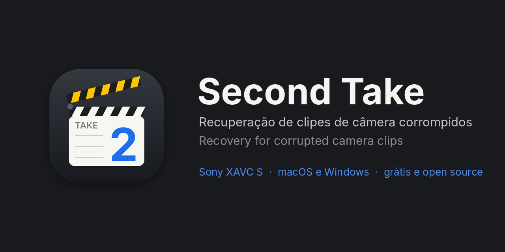

# Second Take



**Recuperação de clipes de câmera corrompidos — dá uma segunda chance ao take.**
*Recovery for corrupted camera clips — [English below](#english).*

O Second Take (macOS e Windows) diagnostica e recupera arquivos de vídeo **Sony XAVC S** (FX3, FX3A, FX30 e similares) danificados por cartão retirado durante a gravação, bateria que acabou, cópia incompleta ou setores ruins. Ele preserva **vídeo, áudio LPCM, metadados, timecode e datas do arquivo** e **nunca altera os arquivos originais**: tudo é gravado como cópia numa pasta de saída (ou na subpasta `Second Take`, dentro da pasta do clipe), sem recodificar nada.

Desenvolvido pela [Super8 Produtora](https://instagram.com/super8produtora) a partir de um caso real de set, e distribuído como software livre (GPL v3).

## O que ele resolve

| Nível | Situação | O que o Second Take faz | Sufixo da saída |
|---|---|---|---|
| 1 | Início do arquivo corrompido, índice (`moov`) íntegro | Troca o cabeçalho pelo de um clipe bom da mesma câmera e mantém o índice original | `_REPARADO` |
| 1 | Gravação interrompida: sem índice | Reconstrói o índice varrendo os dados brutos, bloco a bloco, usando um clipe de referência como molde | `_RECONSTRUIDO` |
| 2 | Trechos danificados no meio ou no começo | Pula os blocos ilegíveis e retoma no próximo keyframe (IDR), sem artefatos | `_RECONSTRUIDO` |
| 3 | Casos difíceis | Modo **Avançado**: escolha manual da referência, offset dos dados e simulação antes de gravar | — |
| 4 | Nada remonta | Extração bruta: vídeo `.h264`, áudio `.wav` e um MP4 limpo | `_EXTRAIDO` |

O app funciona em **português e inglês**: segue o idioma do macOS, e o menu **Idioma** (ou **Ajustes…**, ⌘,) troca na hora. No terminal, use `--lang en`.

O app escolhe o nível automaticamente para cada arquivo e gera um `relatorio_reparo.csv` com diagnóstico, referência usada, metadados técnicos, pico de áudio e verificação. Ele avisa, por exemplo, quando o áudio já foi gravado em silêncio, que é um problema do set e não do arquivo.

### Metadados, timecode e prévia

- **XML da câmera** (`C0001M01.XML`): modelo, número de série, lente, codec XAVC, fps de gravação e de captura (S&Q), gamma/primárias (S-Log3, S-Gamut3.Cine…), data e o timecode LTC. O XML vai junto com o clipe reparado.
- **Escolha da referência pela assinatura técnica**: câmera, codec (H.264 × H.265), codec XAVC, fps, resolução e áudio, do XML e do índice. A referência idêntica é testada primeiro.
- **Timecode**: o MP4 limpo da extração bruta ganha uma trilha `tmcd` com o LTC do XML (drop-frame em 29,97/59,94). Nos níveis 1 e 2 o timecode original é mantido.
- **Datas do arquivo**: o recuperado fica com a data de modificação do original, então a ilha ordena pela hora da filmagem.
- **Prévia de 3 quadros** no painel Detalhes (10 %, 50 % e 90 %), lida direto pelo índice: funciona também com o cabeçalho danificado e com o arquivo recém-recuperado. Precisa do ffmpeg. Em S-Log3 a imagem vem sem LUT.

### Como funciona

O XAVC S grava os dados em blocos regulares de cerca de 0,5 s: `[metadados rtmd][G quadros H.264][áudio LPCM]`. Cada quadro começa com um *access unit delimiter* (NAL tipo 9). Com um clipe íntegro da mesma câmera e da mesma configuração como molde (tamanho dos blocos, `avcC`, padrão de GOP e `ctts`), o Second Take reconhece cada bloco no arquivo danificado e reescreve as tabelas de amostras (`stts`, `ctts`, `stsc`, `stsz`, `stco/co64`, `stss`). Os bytes de vídeo e áudio não são recodificados: o resultado é **bit a bit idêntico** ao que a câmera gravou.

Toda saída é gravada primeiro num `.part` oculto e só recebe o nome final depois de gravada por inteiro (um disco cheio ou um SSD desconectado no meio não deixam arquivo cortado com cara de pronto). Nada é sobrescrito: um segundo reparo na mesma pasta gera `_2`, `_3`…

### Arquitetura

```
src/secondtake/
  core.py      diagnóstico, escolha da referência, troca de cabeçalho, metadados (moov, SPS, hvcC, XML), prévia, CSV
  rebuild.py   árvore de boxes MP4, perfil da referência, varredura dos blocos, resync, novo moov, extração bruta
  safeio.py    escrita atômica (.part + fsync + rename) e nomes livres (_2, _3…)
  gui.py       interface (CustomTkinter + tkinterdnd2), diálogos, tela de apresentação, teste de fumaça
  i18n.py      catálogo português/inglês e preferências
  updater.py   aviso de versão nova (GitHub Releases)
  cli.py       linha de comando (scan / repair)
```

A interface não tem lógica de recuperação: tudo passa por `core`/`rebuild`, que a linha de comando também usa. O trabalho pesado roda em threads; a interface conversa com elas por uma fila.

## Instalação

**App para macOS (Apple Silicon):** baixe o instalador `.dmg` mais recente em [Releases](../../releases/latest), abra e arraste o **Second Take** para Aplicativos. A janela do instalador mostra os passos abaixo, junto com o `Leia-me · Read me.txt`.

O app ainda não é notarizado pela Apple, então na primeira abertura o macOS avisa que não conseguiu verificá-lo. Feche o aviso (não mova para o Lixo) e libere o app de uma destas formas:
- **Ajustes do Sistema > Privacidade e Segurança:** no DMG, dê dois cliques em **Abrir Ajustes de Segurança**, role até o fim, clique em **Abrir Mesmo Assim** e confirme.
- **Terminal:** `xattr -cr "/Applications/Second Take.app"`

Isso só é necessário uma vez. Quando sair uma versão nova, o próprio app avisa (no máximo uma vez por dia, desligável em Ajustes) e o botão **Baixar** abre o instalador novo. Para mandar a um colega, use **Ajuda > Como instalar em outro Mac/PC**: o app copia o link e as instruções prontos para colar.

**Windows 10/11 (64 bits):** baixe o `SecondTake-…-Windows-x64-Setup.exe` em [Releases](../../releases/latest) e siga o instalador (não precisa de senha de administrador). Se preferir não instalar, use o `.zip` portátil: descompacte e abra `Second Take.exe`. Como o app ainda não tem certificado de assinatura, o Windows pode mostrar *"O Windows protegeu o computador"*: clique em **Mais informações > Executar assim mesmo**. Para a verificação dos reparos, instale o ffmpeg com `winget install Gyan.FFmpeg` (opcional).

**Conferir o download (opcional):** cada release traz um `SHA256SUMS.txt`. Na pasta do download:
```bash
shasum -a 256 -c SHA256SUMS.txt --ignore-missing          # macOS
```
```powershell
Get-FileHash .\SecondTake-*-Setup.exe -Algorithm SHA256   # Windows: compare com a linha do arquivo
```

**Pelo código:**
```bash
git clone https://github.com/felipelimas8/secondtake.git
cd secondtake
python3 -m pip install -e .
secondtake-gui            # interface
secondtake --help         # linha de comando
```

Requisitos: Python 3.10+ com Tkinter (o instalador do python.org já inclui). O **ffmpeg** é opcional (`brew install ffmpeg`). Ele é usado para conferir os quadros reparados e montar o MP4 limpo da extração bruta.

## Uso

Para experimentar sem material real, baixe `SecondTake-amostras-teste.zip` na página da release: são 5 clipes sintéticos, cada um com um tipo de dano, e um LEIA-ME dizendo o que esperar.

### Interface
1. **Analisar**: escolhe uma pasta de brutas e examina todos os clipes. **Analisar arquivos…** examina só os clipes escolhidos e busca referências na mesma pasta.
2. Os arquivos reparáveis já vêm selecionados. Clique em **Reparar selecionados**.
3. Selecione um clipe para ver os **Detalhes**: metadados técnicos e uma prévia de três quadros (10 %, 50 % e 90 %), também em clipes com cabeçalho danificado e logo após o reparo.
4. **Avançado…** abre os controles manuais de um arquivo: modo, referência, offset e **Simular**.
5. **Salvar junto dos originais** (chave no rodapé): grava cada recuperado na subpasta `Second Take` dentro da pasta do próprio clipe. O app nunca grava ao lado do original.

### Linha de comando
```bash
secondtake scan  /Volumes/CARTAO/PRIVATE/M4ROOT/CLIP
secondtake repair C0042.MP4 C0043.MP4 -o ~/Movies/SecondTake --verify
secondtake repair C0042.MP4 -o saida --mode reconstruir --ref C0041.MP4
secondtake repair /Volumes/CARTAO/PRIVATE/M4ROOT/CLIP --beside
```

**Dica:** o disco de saída precisa ter permissão de escrita. Discos **NTFS** são somente leitura no macOS, então use outro destino.

## Limitações conhecidas

- **Câmeras validadas:** só a Sony FX3, em XAVC S-I 4K 4:2:2 10-bit (23,98p e 59,94p), com material real. Outras câmeras XAVC S devem funcionar, mas ainda não foram validadas. Relate o resultado numa *issue*.
- **XAVC HS (H.265 / HEVC), suporte parcial:** o app reconhece o codec (`hvc1`/`hev1`, também pelo conteúdo quando o índice sumiu), mostra perfil, nível, 4:2:2 e 10-bit no Detalhes, gera a prévia e faz a **troca de cabeçalho** (nível 1). A reconstrução do índice e a extração bruta ainda não: dependem do layout dos blocos XAVC HS, que vai ser medido num clipe real da câmera. Até lá, esses clipes aparecem com o diagnóstico "XAVC HS (H.265) sem índice: reconstrução ainda não suportada" e ficam fora do lote.
- Outras marcas (Canon, Panasonic, DJI, GoPro, iPhone) ainda não são suportadas.
- **Referência obrigatória:** a reconstrução precisa de pelo menos um clipe íntegro da mesma câmera, com a mesma resolução, fps e codec.
- **Último bloco:** numa gravação interrompida, o último bloco (cerca de 0,5 s) costuma ser perdido. Com B-frames, até 2 quadros do fim de um GOP incompleto também se perdem.

## Desenvolvimento

```bash
python3 -m venv .venv && source .venv/bin/activate
python -m pip install --require-hashes -r requirements-build.txt
python -m pip install --no-deps -e .
python -m pytest
```

O `requirements-build.txt` trava as versões (com hash SHA-256) do CustomTkinter, tkinterdnd2, Pillow, PyInstaller e pytest, as mesmas do build oficial. Uma versão nova de biblioteca só entra de propósito: edite `requirements-build.in`, regenere com o comando no topo do `.txt` e teste o app empacotado. O `pyproject.toml` mantém faixas amplas para quem instala com `pip install -e .`.

### Testes

A suíte **não usa material de câmera**. O `tests/synth.py` gera clipes sintéticos no layout XAVC S com o ffmpeg (libx264, ou libx265 4:2:2 10-bit para XAVC HS, mais LPCM e rtmd) e escreve o `moov` por conta própria, sem usar o código do app. Os testes simulam cada tipo de dano e conferem quadro a quadro (`framemd5`) e amostra a amostra que o recuperado é idêntico ao original.

| Arquivo | Cobre |
|---|---|
| `test_recovery.py` | níveis 1 a 4, `.RSV`, resync, referência manual, escrita atômica, numeração `_2`, timeouts, cancelamento, pastas de saída, CLI |
| `test_hardening.py` | `find_moov`, cache de perfis, CSV contra fórmulas, `config.json`, XML com `defusedxml`, arquivos malformados |
| `test_pro.py` | datas preservadas, timecode na extração, referência pela assinatura técnica, prévia de 3 quadros |
| `test_hevc.py` | XAVC HS: `hvcC` (perfil/nível/4:2:2/10-bit), codec pelo conteúdo do `mdat`, troca de cabeçalho bit a bit, recusa da reconstrução, prévia |
| `test_i18n.py` | catálogo completo PT/EN, mesmos parâmetros nos dois idiomas, CSV em inglês |
| `test_updater.py` | comparação de versões, intervalo de 24 h, pular versão, 404, escolha do instalador por sistema |

Sem ffmpeg (ou sem libx265, no caso do HEVC) os testes que precisam dele são pulados. A interface não tem teste automático no pytest: ela é conferida pelo teste de fumaça do app empacotado (abaixo) e à mão.

**Nunca envie material de clientes para o repositório**, nem em *issues*. Veja o [CONTRIBUTING.md](CONTRIBUTING.md).

### Build e publicação

Para gerar o app e o instalador no macOS: `brew install create-dmg` e depois `scripts/build_macos.sh` (o `.app`, o `.dmg` e o `.zip` saem em `dist/`; com `--install`, também copia para Aplicativos, com o app fechado). O ícone e o fundo do instalador são gerados por `scripts/make_assets.py`. No Windows, com [Inno Setup 6](https://jrsoftware.org/isinfo.php) instalado: `.\scripts\build_windows.ps1` (gera o `Setup.exe` e o `.zip` portátil em `dist\`). Os dois scripts instalam as dependências pelo `requirements-build.txt`.

**Teste de fumaça:** `python scripts/smoke_test.py "dist/Second Take.app/Contents/MacOS/Second Take"` (ou `"dist\Second Take\Second Take.exe"`) abre o app empacotado com `SECONDTAKE_SMOKE=1`, que monta a janela principal sem a tela de apresentação e sem rede, roda o loop do Tk por 1,5 s, confere janela, ícone e arrastar e soltar, e fecha com código 0. Pega o que só quebra no app congelado: dado que o PyInstaller não levou, import faltando, erro em callback na abertura.

GitHub Actions:

| Workflow | Quando | O que faz |
|---|---|---|
| `tests.yml` | push e PR na `main` | pytest no Linux, Python 3.10 e 3.13 |
| `build.yml` | push na `main` | macOS e Windows em paralelo: testes, app, teste de fumaça; se os dois passarem, recria a pré-release [Última versão (main)](../../releases/tag/main-build) com todos os arquivos e o `SHA256SUMS.txt` |
| `release.yml` | tag `v*` | o mesmo, publicando a release oficial. Se um dos sistemas falhar, nada é publicado |

As actions estão fixadas por SHA de commit (a versão fica no comentário) e só o job que publica tem permissão de escrita no repositório.

## Licença

Copyright © 2026 Super8 Produtora. Distribuído sob a **GNU General Public License v3.0 ou posterior**: veja [LICENSE](LICENSE). Você pode usar, estudar, modificar e redistribuir. Versões modificadas que forem distribuídas também precisam ter o código aberto sob a GPL.

---

## English

**Second Take** (macOS and Windows) diagnoses and recovers corrupted **Sony XAVC S** clips (FX3, FX3A, FX30 and similar) damaged by a card pulled mid-recording, a dead battery, an incomplete copy or bad sectors. It preserves **video, LPCM audio, metadata, timecode and file dates**, and **never modifies the originals**: everything is written as a copy to an output folder (or to a `Second Take` subfolder next to the clip).

| Level | Damage | What it does |
|---|---|---|
| 1 | Corrupted header, intact `moov` | Swaps in a good header from a clip shot on the same camera |
| 1 | Interrupted recording (no `moov`) | Rebuilds the index by walking the raw XAVC chunks, using a reference clip as template |
| 2 | Damage in the middle or at the start | Skips unreadable chunks and resumes at the next IDR keyframe |
| 3 | Hard cases | **Advanced** dialog: manual reference, data offset and dry-run |
| 4 | Nothing else works | Raw extraction to `.h264` + `.wav` + clean MP4 |

Nothing is re-encoded, so the recovered frames are bit-identical to what the camera wrote. The test suite proves this on synthetic XAVC S clips generated with ffmpeg, so no client footage is needed.

It also reads the Sony camera XML (model, serial, lens, S&Q capture rate, S-Log3/S-Gamut3, LTC timecode), uses it to pick the best reference clip, writes a timecode track into raw-extraction MP4s, keeps the original file dates, and shows a 3-frame preview read straight from the index (works on header-damaged clips too).

**XAVC HS (H.265):** partial support. Codec detection (`hvc1`/`hev1`, or from the raw `mdat` when the index is gone), profile/level/4:2:2/10-bit details, preview and header repair work. Index rebuild and raw extraction for HEVC wait for a real camera sample; those clips are reported and skipped.

Each release ships a `SHA256SUMS.txt` (`shasum -a 256 -c SHA256SUMS.txt --ignore-missing`). Builds use pinned, hash-checked dependencies (`requirements-build.txt`) and every packaged app is launched by a smoke test before anything is published.

```bash
pip install -e .
secondtake repair /path/to/CLIP -o ~/Movies/SecondTake --verify
secondtake-gui
```

The app is not notarized yet: on first launch click **Done**, then go to *System Settings > Privacy & Security > Open Anyway* (or run `xattr -cr "/Applications/Second Take.app"`).

Licensed under GPL-3.0-or-later. The app, the diagnoses, the CSV report and the CLI are available in **English and Portuguese**: it follows the macOS language, and you can switch it from the **Language** menu or **Settings…** (⌘,) (`--lang en` on the command line).
